

<picture><source media="(prefers-color-scheme: light)" srcset="./assets/zoom-light.svg" /></picture>

 

<picture><source media="(prefers-color-scheme: light)" srcset="./assets/about-light.svg" /></picture>

 

<picture><source media="(prefers-color-scheme: light)" srcset="./assets/heading-frontend-light.svg" />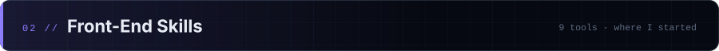</picture>

<a href="https://www.w3schools.com/css/" target="_blank" rel="noreferrer">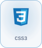</a>

<a href="https://getbootstrap.com/" target="_blank" rel="noreferrer">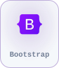</a>
<a href="https://sass-lang.com" target="_blank" rel="noreferrer">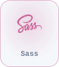</a>
<a href="https://www.chartjs.org" target="_blank" rel="noreferrer">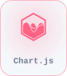</a>
<a href="https://reactjs.org/" target="_blank" rel="noreferrer">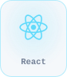</a>
<a href="https://www.photoshop.com/en" target="_blank" rel="noreferrer">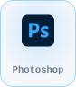</a>

<picture><source media="(prefers-color-scheme: light)" srcset="./assets/heading-testing-light.svg" />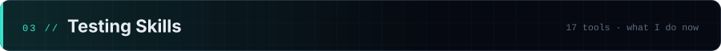</picture>

<a href="https://postman.com" target="_blank" rel="noreferrer">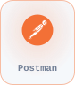</a>
<a href="https://apidog.com" target="_blank" rel="noreferrer">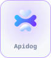</a>

<a href="https://www.selenium.dev" target="_blank" rel="noreferrer">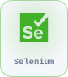</a>
<a href="https://www.cypress.io" target="_blank" rel="noreferrer">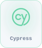</a>
<a href="https://www.jenkins.io" target="_blank" rel="noreferrer">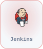</a>

<a href="https://git-scm.com/" target="_blank" rel="noreferrer">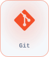</a>
<a href="https://gitlab.com" target="_blank" rel="noreferrer">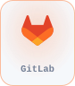</a>
<a href="https://portswigger.net/burp" target="_blank" rel="noreferrer">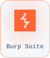</a>
<a href="https://www.atlassian.com/software/jira" target="_blank" rel="noreferrer">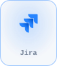</a>
<a href="https://www.testrail.com" target="_blank" rel="noreferrer">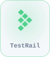</a>
<a href="https://www.testmo.com" target="_blank" rel="noreferrer">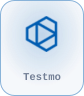</a>

<a href="https://www.elastic.co/kibana" target="_blank" rel="noreferrer">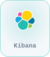</a>

<picture><source media="(prefers-color-scheme: light)" srcset="./assets/heading-socials-light.svg" />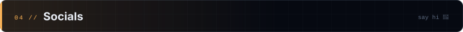</picture>

